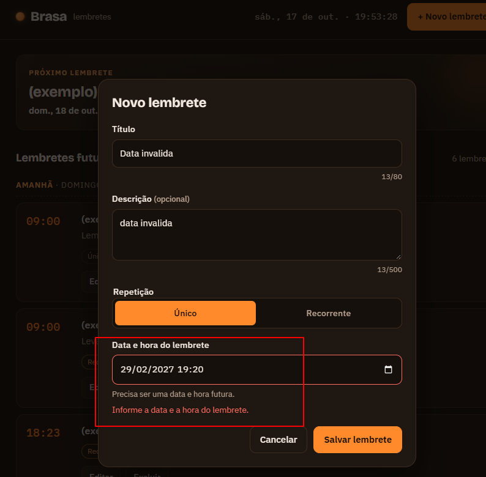

**Defeito**  
Baseado na ISO-29119-3 e em ferramentas de gestão de defeitos. 

| ID | 01 |
| :---- | :---- |
| **Título** | O sistema mostra a mensagem de erro ‘Precisa ser uma data e hora futura’ ‘Informe a data e a hora do lembrete’ ao colocar a data inválida 29/02/2027 |
| **Testador** | Isabella Henriques |
| **Data e Hora** | 17/10/2026 \- 19:20 |
| **Resultado Esperado** | Mensagem de erro informando que a data é inválida |
| **Resultado Atual** | O sistema mostra a mensagem de erro ‘Precisa ser uma data e hora futura’ ‘Informe a data e a hora do lembrete’ ao colocar a data inválida 29/02/2027 |
| **Evidências** | [Visualizar imagem da evidência](./img/Brasa-Lembretes-10-17-2026_07_23_PM.png) |
| **Prioridade** | Baixa |
| **Severidade** | Baixa |
| **Informações sobre  o Software** | file:///C:/Projetos%20GitHub/brasa-lembretes/index.html |
| **Rastreabilidade** | [Relatório de Sessão 1](./Relatorio_de_Sessao.md#relat%C3%B3rio-de-sess%C3%A3o-1) |
| **Status** | To Do |

